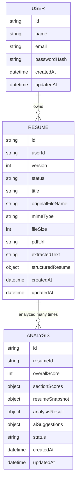

# ResumeForge ER Diagrams

This document defines both the logical and physical Entity Relationship Diagrams for ResumeForge MVP.

Current scope supports:

* Authentication
* Resume Upload
* Resume Parsing
* Resume Analysis
* Section-wise AI Suggestions
* Resume Export

Job Title and Job Description support will be introduced in **Phase 2** and are intentionally excluded from this model.

---

# 1. Logical ER Diagram (Business Domain)



---

# Business Relationships

## User → Resume

* One User owns many Resumes.
* Every Resume belongs to exactly one User.

---

## Resume → Analysis

* One Resume may have multiple Analyses.
* Every Analysis belongs to exactly one Resume.
* Each Analysis represents one immutable resume evaluation.

---

# Ownership

```text
User
│
└── Resume
      │
      ├── Uploaded PDF
      ├── Extracted Text
      ├── Structured Resume (Resume JSON)
      │
      └── Analysis
            ├── Resume Snapshot
            ├── Section Scores
            ├── Analysis Result
            └── AI Suggestions
```

---

# Resume Status

Resume lifecycle.

```text
UPLOADED

↓

PARSING

↓

PARSED

↓

ANALYZED

↓

FAILED
```

---

# Analysis Status

Analysis lifecycle.

```text
PENDING

↓

RUNNING

↓

COMPLETED

↓

FAILED
```

---

# Cascade Delete Rules

Deleting User deletes

* All Resumes
* All Analyses
* Uploaded Files

Deleting Resume deletes

* All Analyses
* Generated exports

Storage cleanup handled by application.

---

# 2. Physical ER Diagram (PostgreSQL)

```mermaid
erDiagram

    USERS ||--o{ RESUMES : "FK userId (Cascade)"
    RESUMES ||--o{ ANALYSES : "FK resumeId (Cascade)"

    USERS {
        UUID id PK
        VARCHAR_100 name
        VARCHAR_255 email UK
        TEXT passwordHash
        TIMESTAMPTZ createdAt
        TIMESTAMPTZ updatedAt
    }

    RESUMES {
        UUID id PK
        UUID userId FK
        INTEGER version
        VARCHAR_30 status
        VARCHAR_255 title NULL
        TEXT originalFileName
        VARCHAR_100 mimeType
        INTEGER fileSize
        TEXT pdfUrl
        TEXT extractedText
        JSONB structuredResume
        TIMESTAMPTZ createdAt
        TIMESTAMPTZ updatedAt
    }

    ANALYSES {
        UUID id PK
        UUID resumeId FK
        INTEGER overallScore
        JSONB sectionScores
        JSONB resumeSnapshot
        JSONB analysisResult
        JSONB aiSuggestions
        VARCHAR_30 status
        TIMESTAMPTZ createdAt
        TIMESTAMPTZ updatedAt
    }
```

---

# Primary Keys

* users.id
* resumes.id
* analyses.id

---

# Foreign Keys

* resumes.userId → users.id
* analyses.resumeId → resumes.id

Both use:

```sql
ON DELETE CASCADE
```

---

# Indexes

## users

* UNIQUE(email)

---

## resumes

* INDEX(userId)
* INDEX(status)

---

## analyses

* INDEX(resumeId)
* INDEX(status)
* INDEX(createdAt DESC)

---

# JSONB Fields

## Resume

### structuredResume

Stores canonical Resume JSON generated by Parsing Module.

Example sections

* Contact
* Summary
* Experience
* Education
* Skills
* Projects
* Certifications

Every backend module consumes this object.

Raw PDFs are never used after parsing.

---

## Analysis

### sectionScores

Stores per-section scores.

Example

```json
{
  "contact": 100,
  "summary": 78,
  "experience": 92,
  "education": 96,
  "skills": 64,
  "projects": 81
}
```

---

### resumeSnapshot

Immutable snapshot of Resume JSON at analysis time.

Prevents historical analyses from changing after resume edits.

---

### analysisResult

Stores deterministic output from Resume Analysis Engine.

Examples

* ATS score
* Formatting checks
* Resume health
* Missing metrics
* Readability
* Validation results

---

### aiSuggestions

Stores AI-generated recommendations.

Examples

* Summary rewrite
* Experience improvements
* Skills recommendations
* Education suggestions
* Contact improvements

AI suggestions remain separate from business analysis.

---

# Design Principles

* Business entities modeled relationally.
* Complex resume structures stored as JSONB.
* Resume JSON is canonical domain model.
* Analyses are immutable historical snapshots.
* AI suggestions separated from deterministic analysis.
* Database optimized for simplicity and future scalability.

---

# Phase 2 Evolution

Future versions introduce Target-based optimization.

New entities

```text
Resume

↓

Target

(Job Title / Job Description)

↓

Comparison

↓

Analysis
```

Future tables

* TARGETS
* TARGET_PROFILES

Current MVP intentionally excludes these tables to keep schema focused on General Resume Analysis.
