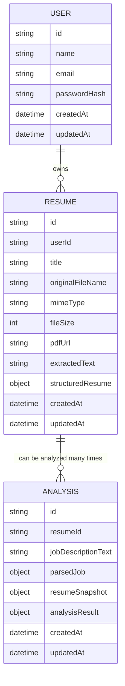

# ER Diagrams

This document contains both the logical and physical Entity Relationship Diagrams for the Resume Analyzer SaaS.

---

## 1. Logical ER Diagram (Business Domain View)

This diagram focuses on business entities, ownership, and cardinality without database implementation details.



---

## Business Relationships

## User → Resume

- One User owns many Resumes.
- Every Resume belongs to exactly one User.

---

## Resume → Analysis

- One Resume can have many Analyses.
- Every Analysis belongs to exactly one Resume.
- Each Analysis represents a comparison between one Resume and one Job Description.

---

## Ownership

```

User
│
└── Resume
      │
      ├── Uploaded PDF
      ├── Extracted Text
      ├── Structured Resume
      │
      └── Analysis
            ├── Parsed Job
            ├── Resume Snapshot
            └── Analysis Result
```

---

# Cascade Delete Rules

Deleting a User deletes:

- All Resumes
- All Analyses
- Uploaded resume files (handled by the application)

Deleting a Resume deletes:

- All Analyses created from that Resume

---

# 2. Physical ER Diagram (Database View)

This diagram represents the PostgreSQL implementation.

```mermaid
erDiagram

    USERS ||--o{ RESUMES : "FK userId (Cascade)"
    RESUMES ||--o{ ANALYSES : "FK resumeId (Cascade)"

    USERS {
        UUID id PK
        VARCHAR_100 name
        VARCHAR_255 email UK
        TEXT passwordHash
        TIMESTAMPTZ createdAt
        TIMESTAMPTZ updatedAt
    }

    RESUMES {
        UUID id PK
        UUID userId FK
        VARCHAR_255 title NULL
        TEXT originalFileName
        VARCHAR_100 mimeType
        INTEGER fileSize
        TEXT pdfUrl
        TEXT extractedText
        JSONB structuredResume
        TIMESTAMPTZ createdAt
        TIMESTAMPTZ updatedAt
    }

    ANALYSES {
        UUID id PK
        UUID resumeId FK
        TEXT jobDescriptionText
        JSONB parsedJob
        JSONB resumeSnapshot
        JSONB analysisResult
        TIMESTAMPTZ createdAt
        TIMESTAMPTZ updatedAt
    }
```

---

# Database Constraints

## Primary Keys

- users.id
- resumes.id
- analyses.id

---

## Foreign Keys

- resumes.userId → users.id
- analyses.resumeId → resumes.id

Both relationships use **ON DELETE CASCADE**.

---

## Indexes

### users

- UNIQUE(email)

### resumes

- INDEX(userId)

### analyses

- INDEX(resumeId)
- INDEX(createdAt DESC)

---

# JSONB Fields

## Resume

### structuredResume

Stores the normalized representation of the uploaded resume generated by the Parsing Module.

---

## Analysis

### parsedJob

Stores the normalized representation of the job description.

### resumeSnapshot

Stores a snapshot of the parsed resume at the time the analysis was created.

This ensures historical accuracy if the user uploads a new version of their resume later.

### analysisResult

Stores the output produced by:

- Rule Engine
- AI Suggestion Engine

The schema of these JSON objects is documented separately in:

```
docs/contracts/json-schemas.md
```

---

# Design Principles

- Business entities are modeled relationally.
- Complex AI-generated structures are stored as JSONB.
- Analysis records are immutable historical snapshots.
- The database is optimized for simplicity while remaining extensible for future versions.